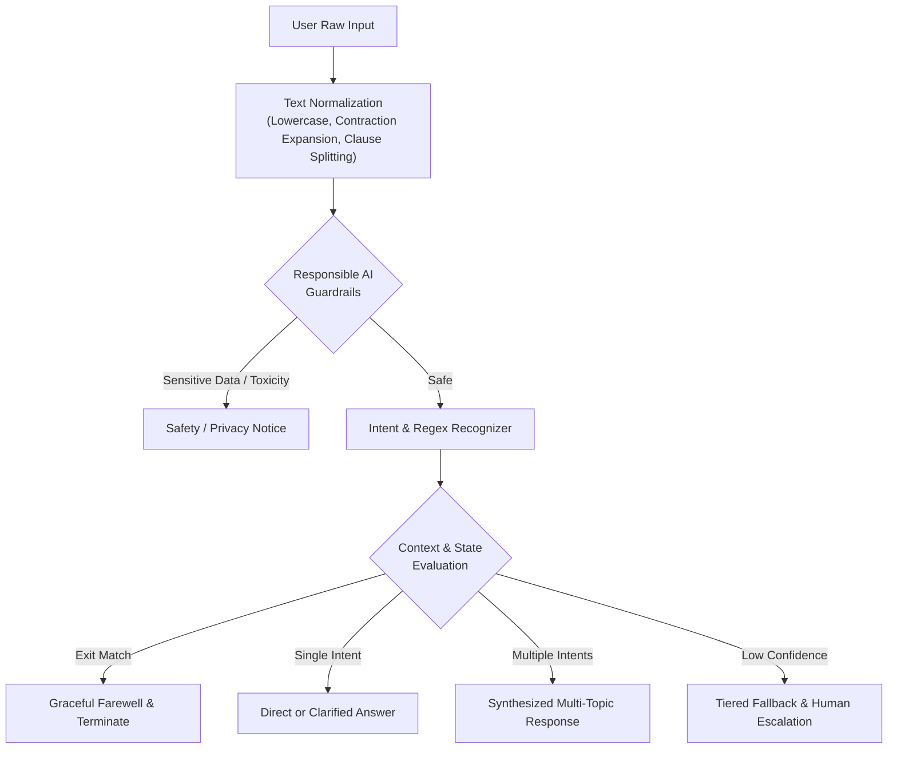

# Rule-Based Interactive Terminal Customer Support Assistant

A responsible, multi-intent conversational assistant built in Python for customer support and product FAQs. It features keyword and regular expression parsing, dialog state tracking, contextual follow-ups, responsible AI guardrails, and graceful fallbacks.

---

## 🌟 Key Features

1. **Multi-Intent Recognition**:
   - Parses compound queries in a single turn using punctuation and coordinating conjunction segmentation.
   - Example: *"Hi, what are your hours and when will I receive my certificate?"* simultaneously greets the user, answers the business hours FAQ, and answers the certificate status query.

2. **Regex & Keyword Pattern Matching**:
   - Comprehensive regular expression engine supporting fuzzy phrasing, synonyms, and variations.
   - Text normalization with contraction expansion (*"what's" &rarr; "what is"*, *"i'm" &rarr; "i am"*), punctuation stripping, and stop-word filtering.

3. **Conversational State Management**:
   - State lifecycle: `GREETING` &rarr; `AWAITING_QUERY` &rarr; `INTENT_IDENTIFICATION` &rarr; `RESOLUTION` / `CLARIFICATION` &rarr; `EXIT`.
   - Remembers user context (e.g. user name if introduced).
   - Handles contextual follow-up questions referencing previous topics (e.g. *"Are you open on weekends?"*, *"Is the repository public or private?"*).

4. **Responsible Conversational AI**:
   - **Transparency**: Clear disclosures about being an automated rule-based assistant.
   - **Privacy Protection**: Regex filters detect and warn against sharing sensitive credentials or credit card numbers in terminal logs.
   - **Respectful Engagement**: Abusive or toxic messages are politely deflected.
   - **Human Escalation**: Provides direct email and telephone support channels when queries fall outside the rule base.

5. **JSON-Driven Knowledge Base**:
   - Dynamic loading from `sample_faq.json`.
   - Automatically indexes questions, answers, and extracts relevant keywords and regex tokens.

6. **Clean Exit Commands**:
   - Graceful termination on `bye`, `exit`, `quit`, `cya`, `see you`, or `q`.

---

## 📁 Project Structure

```
├── chatbot.py           # Core chatbot implementation (state machine, intent engine, terminal UI)
├── sample_faq.json      # JSON FAQ database (greetings and FAQ question-answer pairs)
└── README.md            # Documentation and usage guide
```

---

## 🚀 Getting Started

### Prerequisites
- Python 3.7+ (uses only Python standard library: `re`, `json`, `sys`, `dataclasses`, `enum`, `argparse`). No third-party dependencies required!

### Running the Interactive Assistant

To start the interactive terminal session:
```bash
python chatbot.py
```

### Specifying a Custom FAQ Dataset
You can load a custom JSON FAQ file using the `--faq` flag:
```bash
python chatbot.py --faq path/to/your_faq.json
```

### Running Automated Verification Tests
Run the built-in test suite to verify all single-intent, multi-intent, regex, state transitions, and exit handling:
```bash
python chatbot.py --test
```

### Disabling Terminal Colors (Plain Text Mode)
If your terminal does not support ANSI escape codes:
```bash
python chatbot.py --no-color
```

---

## 💬 Example Interactions

### 1. Multi-Intent Query
```
You > Hi! What are your business hours, and how do I submit my internship project?

Assistant > Hello!
I noticed you asked multiple questions. Here are the answers to each:
• What are your hours of operation?
  We operate Monday through Friday from 9:00 AM to 6:00 PM IST.
• How do I submit my internship project?
  You can submit your public GitHub repository link through your Student Workspace.
Feel free to ask if you need further clarification on any of these!
```

### 2. Contextual Follow-up
```
You > What are your hours of operation?
Assistant > We operate Monday through Friday from 9:00 AM to 6:00 PM IST.

You > Are you open on weekends?
Assistant > We are closed on weekends (Saturday and Sunday) and national holidays. Support operates strictly Monday to Friday, 9:00 AM to 6:00 PM IST.
```

### 3. Graceful Fallback & Human Escalation
```
You > How do I bake a chocolate cake?
Assistant > I'm sorry, I couldn't quite understand that. Could you please rephrase or ask about one of the following topics?
  • "What are your hours of operation?"
  • "How do I submit my internship project?"
  • "When will I receive my certificate?"

💡 Tip: You can also type 'help' to see all options, or 'exit' to quit.
```

### 4. Clean Exit
```
You > Thank you, bye!
Assistant > Thank you for chatting with us! Have a great day ahead. Goodbye!
```

---

## 📊 Technical Architecture


